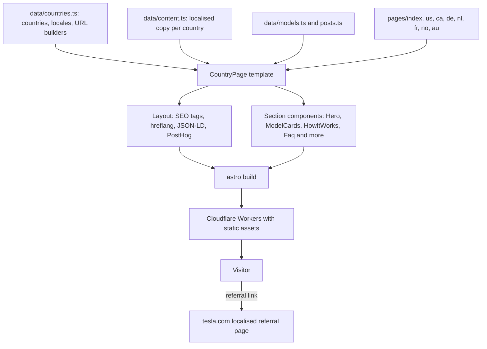

# Tesla Referral Code

A multi-country, multilingual referral site for Tesla's customer referral programme. Visitors pick their country, see the referral benefit that applies there (free Supercharging miles, cash off, or a Full Self-Driving trial), and get sent to the right localised page on tesla.com with the referral already applied.

**Live site:** https://teslareferralcode.co

It is a fully static [Astro](https://astro.build) site written in TypeScript, styled with Tailwind CSS and deployed to Cloudflare Workers. All pages are generated at build time from typed data files, so adding a country or changing an offer is a data change, not a template change.

## Features

**Country and language handling**
- 43 supported countries, grouped into four regions (Europe, North America, Asia/Pacific, Middle East), reachable from a header dropdown
- Dedicated landing pages for 8 of them: UK (the home page), US, Canada, Germany, Netherlands, France, Norway and Australia
- Countries without a landing page link straight to their local tesla.com referral URL, so every country works from day one
- Countries with several languages (for example Canada, Belgium, Switzerland) show one link per language, each pointing to the matching Tesla locale

**Page content**
- One shared page template per country, made up of hero, model cards, how-it-works steps, "why use a referral" copy, embedded videos, FAQ and an all-countries grid
- Per-country offers and copy, fully localised for English, German, Dutch, French and Norwegian
- Model cards adapt to the market, for example hiding Model S and X in Australia, or showing a perk badge only where one exists
- Deep links for each model's order page and new-inventory page, both carrying the referral code
- A small UK blog with three guides

**SEO and performance**
- Per-page title, description, canonical URL, Open Graph and Twitter card tags
- `hreflang` alternates generated from the list of countries that have landing pages
- JSON-LD structured data: `WebSite` and `Offer` on every country page, `FAQPage` from each page's FAQ
- Sitemap generated at build time and referenced from `robots.txt`
- Responsive AVIF model images with `srcset`, explicit dimensions and lazy-loaded YouTube embeds (privacy-enhanced `youtube-nocookie.com` domain)

**Analytics and compliance**
- PostHog event tracking: country page views, referral link clicks, country selection, FAQ expansions and blog clicks
- Affiliate disclosure and non-affiliation disclaimer in the footer, plus about and privacy pages

## Tech stack

| Area | Technology |
| --- | --- |
| Framework | Astro 5 (static output) |
| Language | TypeScript (Astro strict config) |
| Styling | Tailwind CSS 3 with a small custom Tesla-style theme |
| Hosting | Cloudflare Workers with static assets, via `@astrojs/cloudflare` and Wrangler |
| SEO | `@astrojs/sitemap`, JSON-LD, hreflang |
| Analytics | PostHog (`posthog-js`) |

## Architecture



### Data-driven pages

There is a single page template, `CountryPage.astro`. Each landing page file is about eight lines: it looks up a country by slug, looks up that country's content, and renders the template. Two typed data files hold everything that varies:

- `countries.ts` defines each country's code, slug, region, languages (with their Tesla URL locale such as `en_gb`) and whether it has a landing page. It also holds the helper functions that build Tesla URLs.
- `content.ts` defines a `PageContent` type with every string a page needs (SEO text, hero, model perks, three how-it-works steps, FAQ, CTAs) and one fully localised object per country. Because every country's content is typed as `PageContent`, the TypeScript compiler flags a country that is missing a string.

### URL building

All outbound links come from small functions in `countries.ts`, so the referral code and the Tesla URL rules live in one place:

- Referral link: `tesla.com/<locale>/referral/<code>`, with the US using no locale segment
- Order link: `tesla.com/<locale>/<model>/design?referral=<code>`
- Inventory link: `tesla.com/<locale>/inventory/new/<model>?referral=<code>`

`getCountryHref` decides where a country card goes: the local landing page if there is one, otherwise straight to Tesla. As landing pages are added, links switch over automatically.

### Per-market model cards

`ModelCards.astro` reads each model's perk text from the page content. A `null` perk hides that card entirely (Australia has no Model S or X), an empty string shows the card without a perk badge, and a string shows it as a badge. Images are served from sized AVIF variants chosen through `srcset`, based on whether the card is the wide hero card or one of the half-width cards.

### SEO

`Layout.astro` builds canonical URLs from the site origin, emits one `hreflang` link for every country with a landing page plus an `x-default`, and accepts a JSON-LD object or array. `CountryPage.astro` supplies the `WebSite` and `Offer` schemas, and the FAQ section emits a `FAQPage` schema from the same data it renders, so the visible FAQ and the structured data cannot drift apart.

### Analytics

A PostHog snippet is included from `Layout.astro`. Small inline scripts in the hero, FAQ, country selector and blog index send events with the country attached as properties. Analytics calls are optional-chained (`window.posthog?.capture`), so the page works normally if a blocker removes PostHog.

### Deployment

`astro build` produces static HTML plus a worker bundle in `dist/`. `wrangler.jsonc` points Cloudflare Workers at that bundle and serves `dist/` as static assets. `npm run deploy` builds and deploys in one step.

## Project structure

```
src/
  components/
    CountryPage.astro      Shared page template (sections plus JSON-LD)
    CountrySelector.astro  Region-grouped country and language dropdown
    Header.astro, Footer.astro, TeslaLogo.astro, BlogPost.astro, posthog.astro
    sections/              Hero, TrustCounter, ModelCards, HowItWorks,
                           WhyReferral, Videos, Faq, RegionGrid
  data/
    countries.ts           Countries, locales, regions and URL builders
    content.ts             Localised page content per country
    models.ts              Tesla model metadata
    posts.ts               Blog post index
  layouts/Layout.astro     Head tags, SEO, hreflang, JSON-LD, analytics
  pages/                   index (UK), us, ca, de, nl, fr, no, au,
                           about, privacy, blog/
  styles/global.css        Tailwind layers and shared button and container styles
public/
  models/                  AVIF model images in multiple sizes
  robots.txt, favicon.ico
astro.config.mjs           Site URL, Tailwind, sitemap, Cloudflare adapter
wrangler.jsonc             Cloudflare Workers configuration
tailwind.config.mjs        Theme colours, fonts, content width
```

## Setup

Requires Node.js and npm.

```bash
git clone https://github.com/hersh-kat/tesla-referrals.git
cd tesla-referrals
npm install
npm run dev
```

| Command | Description |
| --- | --- |
| `npm run dev` | Start the Astro dev server |
| `npm run build` | Build the site to `dist/` |
| `npm run preview` | Build, then serve with Wrangler locally |
| `npm run deploy` | Build and deploy to Cloudflare Workers |
| `npm run cf-typegen` | Generate Cloudflare Worker types |

### Environment variables

Names only. Both are read at build time and are public by design, since they end up in the browser:

| Variable | Purpose |
| --- | --- |
| `PUBLIC_POSTHOG_PROJECT_TOKEN` | PostHog project token |
| `PUBLIC_POSTHOG_HOST` | PostHog API host |

### Adding a country landing page

1. Set `hasLandingPage: true` for the country in `src/data/countries.ts`.
2. Add a `PageContent` object for it in `src/data/content.ts` and include it in the `content` export.
3. Add `src/pages/<slug>.astro`, copying one of the existing eight-line pages.

## Disclaimer

This is an independent site and is not affiliated with, endorsed by or operated by Tesla. Referral terms are set by Tesla and can change.
